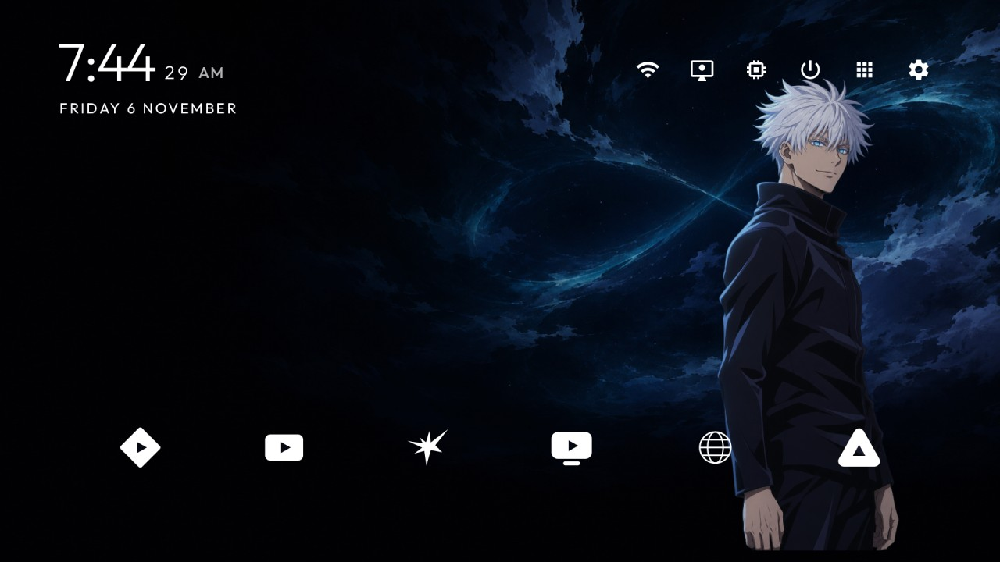
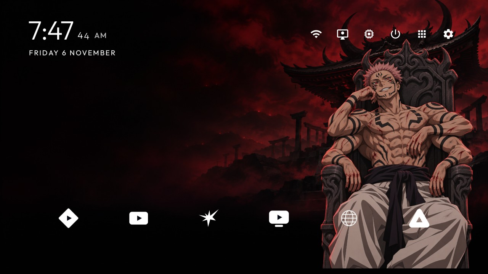

# Personal character launcher

An independent native Java launcher module with an offline theme gallery. The reference `launcher/` is unchanged.

See [artwork credits and licenses](art/CREDITS.md), [device validation and limitations](VALIDATION.md), and [update/restore instructions](RESTORE.md). Only the original Gojo and Sukuna artwork is distributed; additional local themes stay on the owner's TV.




The [Gojo idle](art/screenshots/gojo-idle.jpg) and [Sukuna idle](art/screenshots/sukuna-idle.jpg) captures were taken after 66 seconds.

Build with JDK 17 and Android SDK 34:

```powershell
./gradlew.bat --no-daemon testReleaseUnitTest lintRelease assembleRelease
```

Character presentation is off by default. To opt in for a personal device at build time, append `-PcharacterThemeEnabled=true`. A theme can also be selected manually in **Launcher Settings → Theme Gallery** or **Controls → Theme Gallery**. Gojo and Sukuna are built in. Application order and hidden applications remain in the existing launcher preferences; changing a theme increments the same settings revision that Home already checks.

The gallery offers character motion and optional original synthesized sound. Sound starts off. Reduced motion and the system animator setting suppress character animation and the 1.2 second reveal. Cold Home and screen wake reveal the selected character once; returning from another application does not repeat the reveal. Leaving Home or switching the screen off stops animation callbacks and sound. The existing idle timeout remains five minutes, unless the launcher's existing idle-clock setting overrides it. Its native idle layer uses blue infinity and stars for Gojo, red embers for Sukuna, and a clock over the selected wallpaper for local themes.

## Local artwork

Copy each local theme into a separate folder in the app's `getExternalFilesDir("themes")`. No storage or network permission is needed. For example, `themes/my-theme/theme.json`:

```json
{"title":"My local theme","wallpaper":"wallpaper.jpg"}
```

`name` is accepted as an alternative to `title`. The wallpaper must be a decodable image in the same folder. Nested paths and files outside the theme folder are rejected. Malformed folders are skipped; a missing saved theme falls back to Gojo. Large local images are sampled before decoding. Gallery metadata has a 16 KB limit. Local themes are static wallpaper skins, without character or eye overlays. Keep private artwork outside the repository.

All Apps freezes Home once at one eighth of the display dimensions and blurs the small bitmap on the existing background executor. The full-screen frozen image is fitted to the same decor bounds, with a dark frost tint; it is detached on dismissal. The library focus uses a crisp white rounded border and a flat translucent fill, while Home keeps its existing focus glow.

The module introduces no dependencies, network calls, video, or continuous blur. Built-in character artwork and eye coordinates use a common image transform to keep gaze aligned with the face. Device layout, D-pad operation, wake behavior and performance still require verification on the target TV.

## Focused validation

The gallery changes are covered by `DomainLifecycleTest`, `ThemeCatalogTest`, and `FrostBlurTest`, alongside the existing `LibraryAppsTest`, `LibraryLoadsTest`, `OrderTest`, and `MotionTest` (39 tests total). These check wake ownership and reveal consumption, image sampling and eye counts, blur edge handling, and existing app-library/order/motion behavior. Visual positioning and the one-time backdrop capture cost are checked on the target device.
